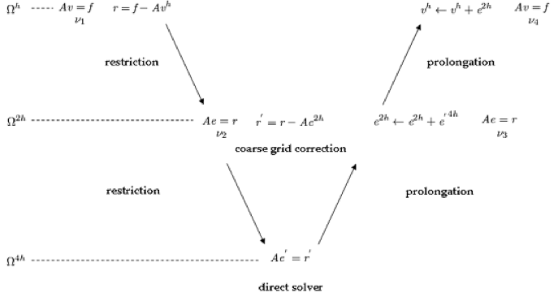

# Multigrid Preconditioner


## The Idea of Preconditioning

In our previous post about the conjugate gradient method, we mentioned that a preconditioner can accelerate convergence when the matrix $A$ is ill-conditioned. The basic idea of preconditioning is straightforward: given a linear system $Ax = b$, we choose a matrix $M \approx A$ and solve $M^{-1}Ax = M^{-1}b$. The goal is to obtain a system that is easier to solve iteratively.

If we choose $M = A$, the preconditioned system can be solved in one step, but this is a meaningless assumption. A more practical approach is to use an iterative solver with inexpensive iterations and run it for only a few steps. The convergence is not neccessary: an approximate application of $A^{-1}$ can be sufficient for preconditioning. In other words, in preconditioning, we do not need to construct $M$ explicitly. We only need a procedure that approximately solves $Ax = b$.

## V-Cycle

Multigrid is well suited for use as a preconditioner. Jacobi and Gauss-Seidel iterations are often used to reduce high frequency error, while low frequency components decay more slowly. This slow decay can limit convergence. The idea of multigrid is to work on grids at different resolutions: error components that are smooth on a fine grid can become more oscillatory on a coarser grid, where smoothing can reduce them more effectively.

The V-cycle puts this idea into practice. First, we construct a hierarchy of levels, either geometrically or algebraically. At each level, we work with a linear system of the form

$$
A_l x_l = b_l,
$$

where $A_l$, $x_l$, and $b_l$ are the matrix, current approximation, and right-hand side at level $l$. A V-cycle combines smoothing, restriction, and prolongation. Smoothing reduces oscillatory error components at the current level, for example through a few Jacobi or Gauss-Seidel iterations. After smoothing, we compute the residual:

$$
r_l = b_l - A_l x_l.
$$

If $x_l^\ast$ is the exact solution at this level, the error is $e_l = x_l^\ast - x_l$ and satisfies

$$
A_l e_l = r_l.
$$

Solving this error equation on the current grid may be expensive, so we approximately solve it on the next coarser grid. We first restrict the residual to form the coarse right-hand side:

$$
b_{l+1} = R_l r_l.
$$

We then approximately solve $A_{l+1}e_{l+1} = b_{l+1}$, starting from a zero initial guess. Finally, we prolong the coarse correction and update the current approximation:

$$
x_l \leftarrow x_l + P_l e_{l+1}.
$$

Here, $R_l$ maps vectors from level $l$ to level $l+1$, and $P_l$ maps them back. These operations are called restriction and prolongation, respectively. THe prolongation may introduce some high frequency error, so we can smooth the solution again.

This process can be implemented recursively. Here is the pseudocode:

```python
A[N] = {...} # matrices in each level

def VCycle(n, b, x):
    if A[n] is a scaler in this level:
        x = b[0] / A[n][0, 0]
        return

    # solve A[n] @ x = b
    smooth() # doing 200 Jacobi iterations
    r = b - A[n] @ x
    r_next = restrict(r, n+1) 

    VCycle(n+1, r_next, delta_x) # solving subproblem in next level recursively

    dx = prolongation(delta_x, n+1)
    x = x + dx # get approximated solution

    smooth()
```

The restriction and prolongation operators depend on how the hierarchy is constructed. Here is a good diagram showing how V-Cycle works (from [COMSOL](https://www.comsol.com/blogs/on-solvers-v-cycle-multigrid)):


<p align = "center">

</p>

A V-cycle can also be used as a standalone iterative solver. Starting from an initial guess, we repeatedly apply V-cycles until the residual is sufficiently small. Alternatively, if a single V-cycle provides a useful approximation at a low cost, we can use it as a preconditioner.

## Multigrid-Preconditioned Conjugate Gradient (MGPCG)

We can use a V-cycle as a preconditioner in the preconditioned conjugate gradient (PCG) method. At each iteration, we apply one V-cycle to approximately solve $Az_k = r_k$. This defines the action of the preconditioner:

$$
z_k = M^{-1}r_k \approx A^{-1}r_k.
$$

The vector $z_k$ is called the preconditioned residual. It is also the residual of the left-preconditioned system $M^{-1}Ax = M^{-1}b$.

We can retain the A-orthogonalization framework from our [Conjugate Gradient Method]() post. **The main change is to compute $z = M^{-1}t$ after computing $t = b - Ax$, and then use $z$ to construct the search direction.**

Why do we still use A-orthogonalization? For symmetric positive-definite $A$ and a fixed symmetric positive-definite $M$, the operator $M^{-1}A$ is self-adjoint in the M-inner product $\langle u,v\rangle_M = u^T Mv$. Its conjugacy condition becomes

$$
\langle a_i, M^{-1}A a_j\rangle_M = a_i^T A a_j = 0\, (i\neq j).
$$

Thus, the direction update keeps the original A-orthogonalization structure, with $z_k$ replacing $t_k$:

$$
a_k = z_k - \frac{z_k^T A a_{k-1}}{a_{k-1}^T A a_{k-1}}a_{k-1}.
$$


The following Python code solves the Poisson problem:

$$
-\nabla^2 u(x,y) = 1 + 10\exp(-100[(x-0.35)^2 + (y-0.62)^2)])
$$

```python
"""
Teaching example: solve -Laplace(u) = f on (0,1)^2, u=0 on boundary
"""

import math
import numpy as np
import taichi as ti

ti.init(arch=ti.cuda)

@ti.kernel
def matvec(A: ti.types.ndarray(dtype=ti.f64, ndim=2),
           x: ti.types.ndarray(dtype=ti.f64, ndim=1),
           y: ti.types.ndarray(dtype=ti.f64, ndim=1)):

    # y = A @ x

    for i in range(y.shape[0]):
        s = ti.cast(0.0, ti.f64)
        for j in range(x.shape[0]):
            s += A[i, j] * x[j]
        y[i] = s


@ti.kernel
def residual_kernel(A: ti.types.ndarray(dtype=ti.f64, ndim=2),
                    x: ti.types.ndarray(dtype=ti.f64, ndim=1),
                    b: ti.types.ndarray(dtype=ti.f64, ndim=1),
                    r: ti.types.ndarray(dtype=ti.f64, ndim=1)):

    # r = b - A @ x

    for i in range(x.shape[0]):
        Ax_i = ti.cast(0.0, ti.f64)
        for j in range(x.shape[0]):
            Ax_i += A[i, j] * x[j]
        r[i] = b[i] - Ax_i


@ti.kernel
def jacobi_step(A: ti.types.ndarray(dtype=ti.f64, ndim=2),
                b: ti.types.ndarray(dtype=ti.f64, ndim=1),
                x_old: ti.types.ndarray(dtype=ti.f64, ndim=1),
                x_new: ti.types.ndarray(dtype=ti.f64, ndim=1)):
    """
    Jacobi step
    x_new = x_old + D^{-1} (b - A @ x_old).
    """
    for i in range(x_old.shape[0]):
        Ax_i = ti.cast(0.0, ti.f64)
        for j in range(x_old.shape[0]):
            Ax_i += A[i, j] * x_old[j]

        x_new[i] = x_old[i] + (b[i] - Ax_i) / A[i, i]


@ti.kernel
def axpy(alpha: ti.f64,
         x: ti.types.ndarray(dtype=ti.f64, ndim=1),
         y: ti.types.ndarray(dtype=ti.f64, ndim=1)):

    # y = y + alpha * x

    for i in range(y.shape[0]):
        y[i] += alpha * x[i]


@ti.kernel
def combine_p(z: ti.types.ndarray(dtype=ti.f64, ndim=1),
              beta: ti.f64,
              p: ti.types.ndarray(dtype=ti.f64, ndim=1)):

    # p = z + beta * p

    for i in range(p.shape[0]):
        p[i] = z[i] + beta * p[i]


@ti.kernel
def copy_vec(src: ti.types.ndarray(dtype=ti.f64, ndim=1),
             dst: ti.types.ndarray(dtype=ti.f64, ndim=1)):
    # dst = src
    for i in range(dst.shape[0]):
        dst[i] = src[i]


@ti.kernel
def dot_kernel(x: ti.types.ndarray(dtype=ti.f64, ndim=1),
               y: ti.types.ndarray(dtype=ti.f64, ndim=1)) -> ti.f64:
    s = ti.cast(0.0, ti.f64)
    for i in range(x.shape[0]):
        s += x[i] * y[i]
    return s


def dot(x, y):
    return float(dot_kernel(x, y))


def norm2(x):
    return math.sqrt(max(dot(x, x), 0.0))


# -----------------------------------------------------------------------------
# Matrix construction
# -----------------------------------------------------------------------------

def idx(i, j, n):
    return i * n + j


def build_poisson_matrix(n):
    # level n
    h = 1.0 / (n + 1)
    inv_h2 = 1.0 / (h * h)
    N = n * n
    A = np.zeros((N, N), dtype=float)

    for i in range(n):
        for j in range(n):
            row = idx(i, j, n)
            A[row, row] = 4.0 * inv_h2
            if i > 0:
                A[row, idx(i - 1, j, n)] = -inv_h2
            if i + 1 < n:
                A[row, idx(i + 1, j, n)] = -inv_h2
            if j > 0:
                A[row, idx(i, j - 1, n)] = -inv_h2
            if j + 1 < n:
                A[row, idx(i, j + 1, n)] = -inv_h2

    return np.ascontiguousarray(A)


def build_transfer(nf, nc):
    # Build bilinear prolongation P
    # and restriction R

    assert nf == 2 * nc + 1

    P1 = np.zeros((nf, nc), dtype=float)
    for i in range(nf):
        p = i + 1
        if p % 2 == 0:
            k = p // 2 - 1
            P1[i, k] = 1.0
        else:
            left = (p - 1) // 2 - 1
            right = (p + 1) // 2 - 1
            if 0 <= left < nc:
                P1[i, left] += 0.5
            if 0 <= right < nc:
                P1[i, right] += 0.5
    P = np.kron(P1, P1).astype(float)

    R = (0.25 * P.T).astype(float)
    return np.ascontiguousarray(R), np.ascontiguousarray(P)


class MGLevel:
    def __init__(self, n, A=None):
        self.n = n
        self.N = n * n
        self.A = build_poisson_matrix(n) if A is None else np.ascontiguousarray(A)
        self.R = None
        self.P = None


class Multigrid:
    def __init__(self, n_fine, pre_sweeps=2, post_sweeps=2):
        self.pre_sweeps = pre_sweeps
        self.post_sweeps = post_sweeps
        self.levels = []

        # Build grid sizes first: 15 -> 7 -> 3 -> 1.
        sizes = []
        n = n_fine
        while True:
            sizes.append(n)
            if n == 1:
                break
            if (n - 1) % 2 != 0:
                raise ValueError("Use n = 2^k - 1, e.g. 7, 15, 31.")
            n = (n - 1) // 2

        self.levels.append(MGLevel(sizes[0]))

        for ell in range(len(sizes) - 1):
            fine = self.levels[ell]
            nc = sizes[ell + 1]
            fine.R, fine.P = build_transfer(fine.n, nc)
            A_coarse = fine.R @ fine.A @ fine.P
            self.levels.append(MGLevel(nc, A=A_coarse))

            rel = np.linalg.norm(fine.R @ fine.A @ fine.P - A_coarse) / np.linalg.norm(A_coarse)
            print(f"level {ell}: ||R A P - A_coarse||/||A_coarse|| = {rel:.3e}")


    def smooth(self, level, x, b, sweeps):
        if sweeps <= 0:
            return
        A = self.levels[level].A
        x_old = x
        x_new = np.empty_like(x)
        for _ in range(sweeps):
            jacobi_step(A, b, x_old, x_new)
            x_old, x_new = x_new, x_old
        if x_old is not x:
            copy_vec(x_old, x)

    def v_cycle(self, level, x, b):
        L = self.levels[level]

        # Bottom of the V: here N=1
        if level == len(self.levels) - 1:
            x[0] = b[0] / L.A[0, 0]
            return

        self.smooth(level, x, b, self.pre_sweeps)
        r = np.zeros(L.N, dtype=float)
        residual_kernel(L.A, x, b, r)

        # restrict
        coarse = self.levels[level + 1]
        r_c = np.zeros(coarse.N, dtype=float)
        matvec(L.R, r, r_c)
        e_c = np.zeros(coarse.N, dtype=float)
        self.v_cycle(level + 1, e_c, r_c)

        # prolonge
        e_f = np.zeros(L.N, dtype=float)
        matvec(L.P, e_c, e_f)
        axpy(1.0, e_f, x)
        self.smooth(level, x, b, self.post_sweeps)


    def apply_preconditioner(self, r):
        z = np.zeros_like(r)
        self.v_cycle(0, z, r)
        return z


# -----------------------------------------------------------------------------
# Solvers
# -----------------------------------------------------------------------------

def relative_residual(A, x, b):
    r = np.zeros_like(b)
    residual_kernel(A, x, b, r)
    bnorm = norm2(b)
    return norm2(r) / (bnorm if bnorm > 0.0 else 1.0)


def solve_by_vcycles(mg, b, tol=1e-10, max_cycles=100):
    A = mg.levels[0].A
    x = np.zeros_like(b)
    history = [relative_residual(A, x, b)]

    for k in range(1, max_cycles + 1):
        mg.v_cycle(0, x, b)
        rr = relative_residual(A, x, b)
        history.append(rr)
        if rr < tol:
            return x, history
    return x, history


def solve_cg(A, b, tol=1e-10, max_iter=1000):
    x = np.zeros_like(b)
    r = b.copy()                  # x=0 => r=b
    p = r.copy()
    rr = dot(r, r)
    bnorm = norm2(b)
    history = [math.sqrt(rr) / bnorm]

    for _ in range(max_iter):
        Ap = np.zeros_like(b)
        matvec(A, p, Ap)
        alpha = rr / dot(p, Ap)

        axpy(alpha, p, x)          # x <- x + alpha p
        axpy(-alpha, Ap, r)        # r <- r - alpha A p

        rr_new = dot(r, r)
        history.append(math.sqrt(rr_new) / bnorm)
        if history[-1] < tol:
            break

        beta = rr_new / rr
        combine_p(r, beta, p)      # p <- r + beta p
        rr = rr_new

    return x, history


def solve_mgpcg(A, b, mg, tol=1e-10, max_iter=1000):
    x = np.zeros_like(b)
    r = b.copy()

    # z = M^{-1} r: THIS is the line connecting MG and PCG.
    z = mg.apply_preconditioner(r)
    p = z.copy()
    rz = dot(r, z)

    bnorm = norm2(b)
    history = [norm2(r) / bnorm]

    for _ in range(max_iter):
        Ap = np.zeros_like(b)
        matvec(A, p, Ap)
        alpha = rz / dot(p, Ap)

        axpy(alpha, p, x)
        axpy(-alpha, Ap, r)

        history.append(norm2(r) / bnorm)
        if history[-1] < tol:
            break

        z = mg.apply_preconditioner(r)
        rz_new = dot(r, z)
        beta = rz_new / rz
        combine_p(z, beta, p)      # p <- z + beta p
        rz = rz_new

    return x, history


def build_rhs(n):
    # f(x,y) = 1 + 10 exp(-100[(x-0.35)^2 + (y-0.62)^2]).
    h = 1.0 / (n + 1)
    b = np.zeros(n * n, dtype=float)
    for i in range(n):
        x = (i + 1) * h
        for j in range(n):
            y = (j + 1) * h
            k = idx(i, j, n)
            bump = math.exp(-100.0 * ((x - 0.35)**2 + (y - 0.62)**2))
            b[k] = 1.0 + 10.0 * bump
    return b


def print_history(name, hist):
    print(f"\n{name}")
    print(f"  iterations/cycles = {len(hist)-1}")
    print(f"  initial relative residual = {hist[0]:.3e}")
    print(f"  final   relative residual = {hist[-1]:.3e}")
    print("  history:")
    # Keep output readable.
    for k, val in enumerate(hist):
        if k < 12 or k == len(hist) - 1 or k % 10 == 0:
            print(f"    {k:3d}: {val:.3e}")
        elif k == 12:
            print("    ...")


def main():
    n = 15
    tol = 1e-10

    mg = Multigrid(n, pre_sweeps=20, post_sweeps=20)
    A = mg.levels[0].A
    b = build_rhs(n)

    # ground truth
    x_ref = np.linalg.solve(A, b)

    print("\n=== Grid hierarchy ===")
    for ell, L in enumerate(mg.levels):
        print(f"level {ell}: {L.n}x{L.n} interior, A shape = {L.A.shape}")
        if L.R is not None:
            print(f"         R shape = {L.R.shape}, P shape = {L.P.shape}")


    x_mg, h_mg = solve_by_vcycles(mg, b, tol=tol, max_cycles=100)
    x_cg, h_cg = solve_cg(A, b, tol=tol, max_iter=1000)
    x_pcg, h_pcg = solve_mgpcg(A, b, mg, tol=tol, max_iter=1000)

    print_history("V-cycle used as solver", h_mg)
    print_history("CG", h_cg)
    print_history("MGPCG", h_pcg)

    print("\n=== Relative error against dense direct solve of the discrete system ===")
    ref_norm = np.linalg.norm(x_ref)
    print(f"V-cycle : {np.linalg.norm(x_mg-x_ref)/ref_norm:.3e}")
    print(f"CG      : {np.linalg.norm(x_cg-x_ref)/ref_norm:.3e}")
    print(f"MGPCG   : {np.linalg.norm(x_pcg-x_ref)/ref_norm:.3e}")


if __name__ == "__main__":
    main()
```

The output is:
```
=== Grid hierarchy ===
level 0: 15x15 interior, A shape = (225, 225)
         R shape = (49, 225), P shape = (225, 49)
level 1: 7x7 interior, A shape = (49, 49)
         R shape = (9, 49), P shape = (49, 9)
level 2: 3x3 interior, A shape = (9, 9)
         R shape = (1, 9), P shape = (9, 1)
level 3: 1x1 interior, A shape = (1, 1)

V-cycle used as solver
  iterations/cycles = 24
  initial relative residual = 1.000e+00
  final   relative residual = 5.822e-11
  history:
      0: 1.000e+00
      1: 5.054e-03
      2: 1.516e-03
      3: 6.966e-04
      4: 3.205e-04
      5: 1.475e-04
      6: 6.789e-05
      7: 3.124e-05
      8: 1.438e-05
      9: 6.617e-06
     10: 3.045e-06
     11: 1.401e-06
    ...
     20: 1.298e-09
     24: 5.822e-11

CG
  iterations/cycles = 52
  initial relative residual = 1.000e+00
  final   relative residual = 9.791e-11
  history:
      0: 1.000e+00
      1: 1.377e+00
      2: 1.502e+00
      3: 1.301e+00
      4: 1.162e+00
      5: 9.124e-01
      6: 6.054e-01
      7: 4.809e-01
      8: 4.202e-01
      9: 3.690e-01
     10: 3.073e-01
     11: 2.337e-01
    ...
     20: 1.100e-02
     30: 2.098e-04
     40: 5.979e-07
     50: 5.915e-10
     52: 9.791e-11

MGPCG
  iterations/cycles = 6
  initial relative residual = 1.000e+00
  final   relative residual = 2.748e-11
  history:
      0: 1.000e+00
      1: 4.219e-03
      2: 1.440e-03
      3: 5.552e-05
      4: 9.190e-07
      5: 1.293e-08
      6: 2.748e-11

=== Relative error against dense direct solve of the discrete system ===
V-cycle : 7.481e-13
CG      : 4.845e-12
MGPCG   : 1.045e-12
```

